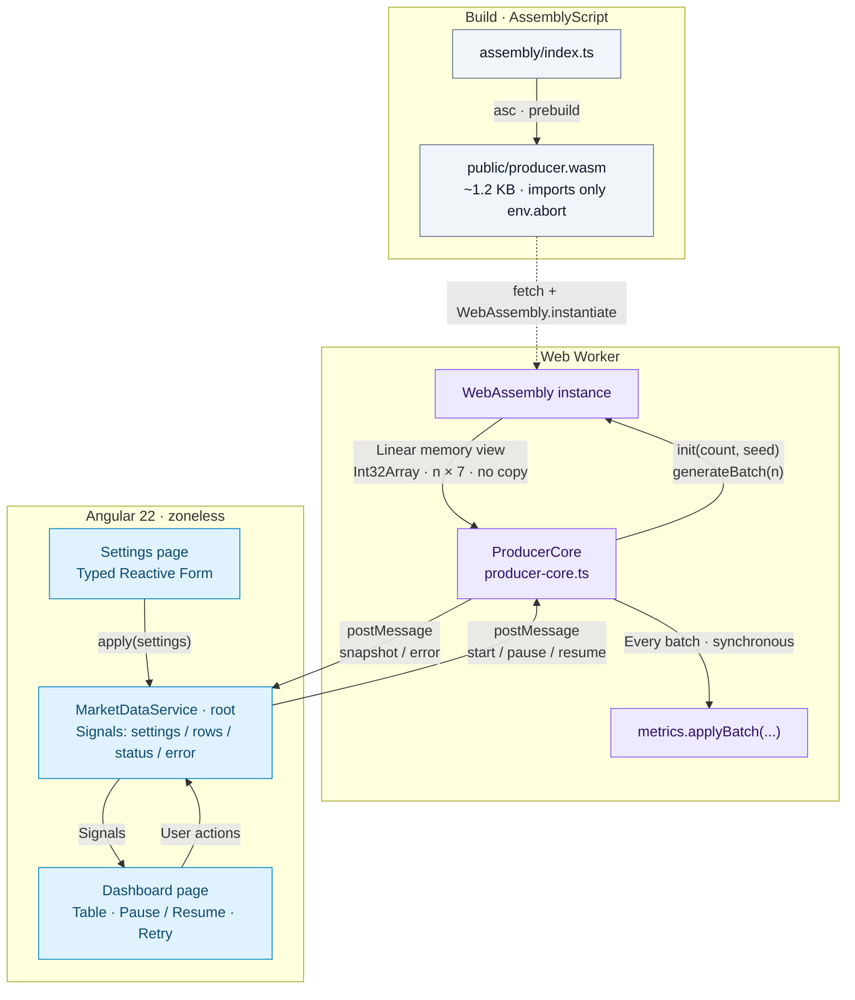

# FinDashboard

[](https://github.com/PavellVit/fin-dashboard/actions/workflows/ci.yml)

Realtime fintech dashboard: Angular 22 with a WebAssembly (AssemblyScript) market-data producer running in a Web Worker.

## Links

- **Live demo:** https://fin-dashboard-ruby.vercel.app/
- **Repository:** https://github.com/PavellVit/fin-dashboard
- **CI:** https://github.com/PavellVit/fin-dashboard/actions/workflows/ci.yml

## Build / Run / Test

Requires Node 24 (see `.nvmrc`).

```bash
nvm use
npm ci
npm start              # dev server on http://localhost:4200
npm run build          # production build -> dist/fin-dashboard/browser
npm test               # unit tests (Vitest via `ng test`), watch mode
npm run test:ci        # Wasm build + single test run + worker typecheck, as in CI
npm run lint           # ESLint (angular-eslint)
npm run format         # Prettier; CI runs format:check
npm run asbuild:debug  # debug Wasm with build/debug.wat to read the generated code
```

- `npm start`, `npm run build` and `npm test` compile `assembly/index.ts` to `public/producer.wasm` first (`prestart`, `prebuild`, `pretest` hooks run `npm run asbuild:release`).
- `public/producer.wasm` and `build/` are git-ignored: the module is built from source on every machine, including the hosting service.
- No Rust, Zig or Emscripten is needed: AssemblyScript is a regular npm dependency.

## Architecture



## Wasm

- **Language:** AssemblyScript 0.28 (TypeScript-like syntax, npm-only toolchain, builds on the hosting service with the rest of the app). Rust would give a more standard Wasm story, but needs `rustup` + `wasm-pack` on every machine and on the build server; for ~100 lines of integer arithmetic that was not worth it.
- **Runtime:** `--runtime stub` (no GC, no allocations after start). All memory is static: a batch buffer for 1000 updates and one `mid` price per instrument.
- **Randomness:** own xorshift32 generator inside the module; `init(count, seed)` takes the seed from JS (`crypto.getRandomValues` in the service, a constant in tests), so tests are deterministic.
- **Price model:** per instrument a random walk of the mid price by up to ±25 cents per update, clamped to $1.00–$1000.00; bid = mid − 1..5 cents, ask = mid + 1..5 cents (spread 2–10 cents); the trade price is the bid or the ask; trade quantity 1–100; book quantities 0–1000 (zero is allowed).
- **Batch layout:** `n × 7` consecutive `i32` values, read by the worker as an `Int32Array` view over `memory.buffer`:

  | #   | field               | #   | field        |
  | --- | ------------------- | --- | ------------ |
  | 0   | instrument index    | 4   | ask (cents)  |
  | 1   | trade price (cents) | 5   | bid quantity |
  | 2   | trade quantity      | 6   | ask quantity |
  | 3   | bid (cents)         |     |              |

  An instrument may appear several times in a batch. Symbols exist only on the TypeScript side; Wasm works with indexes.

- **How to check that the logic really runs in Wasm:** the module imports nothing but `env.abort` (`WebAssembly.Module.imports()`; asserted by the test `imports only env.abort…`), so it cannot call back into JS for randomness or prices. `npm run asbuild:debug` writes `build/debug.wat`.

## CI / Deployment

- **CI:** GitHub Actions (`.github/workflows/ci.yml`) on every push and PR: format check -> lint -> build -> `test:ci` (Wasm build, unit tests, typecheck of the worker code against the webworker lib).
- **Deploy:** Vercel builds every push with `npm run build` (pinned in `vercel.json`, so the `prebuild` hook compiles the Wasm). Deploys are not gated by CI: a failing work-in-progress test never blocks the live demo, and the CI status is visible on every commit. To gate deploys on tests, set `buildCommand` in `vercel.json` to `npm run test:ci && npm run build` (adds ~20–40 s).
- **Push -> live:** measured ~30 s of build time; the new version is served a few seconds later.
